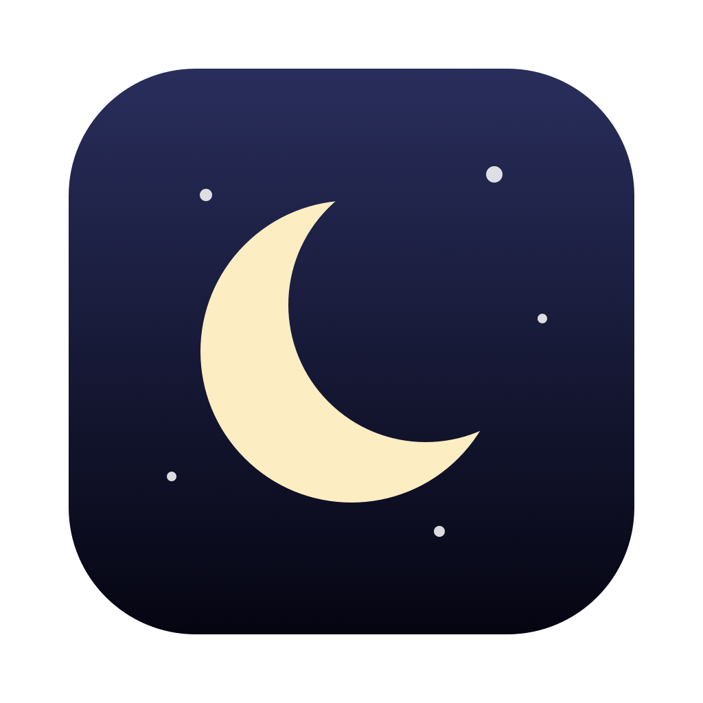
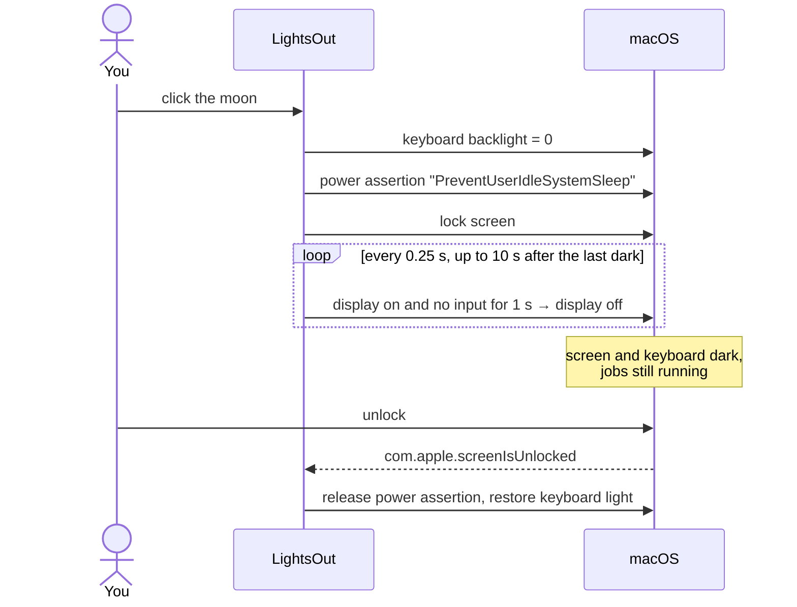

<p align="center">
  
</p>

<h1 align="center">LightsOut</h1>

<p align="center">
  <b>One click to go dark. Your Mac keeps working.</b><br>
  A tiny menu bar app that turns off your MacBook's screen and keyboard light and locks it,<br>
  while Claude Code, builds, downloads and training runs keep going.
</p>

<p align="center">
  <a href="https://github.com/sickpuppy1/lightsout/releases/latest"></a>
  
  
  <a href="https://github.com/sickpuppy1/lightsout/actions/workflows/build.yml"></a>
  <a href="LICENSE"></a>
</p>

---

## The problem

AI coding agents like Claude Code can run for minutes or hours. When you step away, you have two bad options:

- **Leave the lid open.** The screen and keyboard glow all night.
- **Close the lid.** The Mac sleeps and your agent session, build or download stops.

So people tilt the lid *almost* shut and hope the screen turns off without the Mac going to sleep.

**LightsOut is the third option.** Click the moon in your menu bar and every light on the laptop goes off,
the Mac locks, and your work keeps running until you come back.

## What one click does

| Step | What happens |
| --- | --- |
| 1 | **Keyboard backlight → 0** |
| 2 | **Screen locks**, exactly like <kbd>⌃</kbd> <kbd>⌘</kbd> <kbd>Q</kbd> |
| 3 | **Display turns off** as soon as your hands leave the trackpad. If a stray touch wakes it in the next 10 s, it goes dark again. |
| 4 | **The Mac stays awake** so running jobs aren't paused |
| ↩ | **When you unlock**, the keyboard light comes back and your normal sleep settings apply again |

Right-click the moon for **Start at Login** and **Quit**.

## Install

### Option 1: Download (no tools needed)

1. Download **[LightsOut.dmg](https://github.com/sickpuppy1/lightsout/releases/latest/download/LightsOut.dmg)** and open it.
2. Double-click **LightsOut**. It copies itself to Applications, starts at login, and shows a moon in your menu bar.

> **First launch:** LightsOut is not yet notarized by Apple (that needs a paid developer account), so macOS asks you to approve it once.
> - **macOS 15 Sequoia and later:** click *Done*, then go to **System Settings → Privacy & Security**, scroll down and click **Open Anyway**.
> - **macOS 14 and earlier:** right-click **LightsOut** → **Open** → **Open**.

### Option 2: Build from source (no Gatekeeper prompt)

```bash
git clone https://github.com/sickpuppy1/lightsout.git
cd lightsout
./install.sh
```

This needs only Apple's free Command Line Tools (`xcode-select --install`). If `git` works, you already have them.
Apps you compile yourself are not quarantined, so macOS doesn't ask for approval.

### Uninstall

Quit LightsOut from its menu and delete it from Applications, or run `./uninstall.sh`. The script also removes the login entry and settings.

## How it works



| Job | How | Notes |
| --- | --- | --- |
| Stay awake | IOKit power assertion `PreventUserIdleSystemSleep` | Same as `caffeinate -i`: the display may sleep, the system may not. Visible in `pmset -g assertions`. |
| Lock | `SACLockScreenImmediate()` from `login.framework` | The function behind <kbd>⌃⌘Q</kbd>. Falls back to `CGSession -suspend` on older macOS. |
| Display off | `pmset displaysleepnow` | Waits until `HIDIdleTime` (seconds since last keyboard/trackpad input) ≥ 1 s. |
| Keyboard light | `KeyboardBrightnessClient` from `CoreBrightness.framework` | The same interface Control Center uses. Previous level is saved and restored on unlock. |
| Start at login | A LaunchAgent in `~/Library/LaunchAgents` | Behaves the same on every macOS version. `KeepAlive` restarts it after a crash, not after Quit. |

**Why the hands-off wait?** The first version turned the display off after a fixed 1 s delay, and the lock screen kept coming back.
`pmset -g log` showed why: the finger still resting on the trackpad sent a touch event that woke the display in the same second.
Now LightsOut waits for 1 s of no input, then guards for 10 s and turns the display off again if a stray touch wakes it.

## Privacy and permissions

- **No permissions:** no Accessibility, Screen Recording or Full Disk Access prompts.
- **No network access, no analytics, no data collected.**
- **Small enough to read:** the whole app is one ~270-line Objective-C file, [`LightsOut.m`](LightsOut.m).

## Compatibility

| | |
| --- | --- |
| macOS | 10.13 High Sierra and later (Apple Silicon needs 11 Big Sur or later) |
| Hardware | Any Mac. Keyboard-light control applies to MacBooks with a backlit keyboard. |
| Tested on | macOS 15.6, MacBook Air (M1). Reports from other versions are welcome. |

## FAQ

**Can I close the lid?**
No. macOS always sleeps on lid close unless an external display is attached. Overriding that needs `sudo`. LightsOut is built so the lid can stay open while the screen is dark.

**Why not just run `caffeinate`?**
`caffeinate` keeps the Mac awake but leaves the screen and keyboard lit, doesn't lock, and stays on until you remember to kill it.
LightsOut does all of it in one click and hands control back to your normal sleep settings when you unlock.

**What about battery?**
While locked, the Mac stays awake by design, so it drains like an idle Mac with the screen off. Plug in for overnight runs.

**Private APIs? Will this break?**
The lock and keyboard-light calls use undocumented Apple frameworks. They are loaded at runtime and checked first, so if a future macOS removes one,
LightsOut skips that step and still turns off the display.

**Why Objective-C and not Swift?**
It compiles with the stock `clang` that ships in Command Line Tools, with no Xcode project. It also runs on macOS versions older than 10.14.4, which don't include the Swift runtime.

## Project layout

```
LightsOut.m            the whole app: menu bar item, lights-out sequence, self-install
Info.plist             bundle metadata (menu-bar-only app, macOS 10.13+)
build.sh               compile a universal LightsOut.app into build/
install.sh             build from source, copy to ~/Applications, launch
uninstall.sh           remove the app, login agent and settings
release.sh             build dist/LightsOut.dmg (optionally Developer ID signed + notarized)
assets/make-icon.swift draws the app icon in code and writes AppIcon.icns
```

## Releasing

```bash
./release.sh                       # ad-hoc signed DMG in dist/
SIGN_ID="Developer ID Application: Name (TEAMID)" \
NOTARY_PROFILE=notary ./release.sh # signed, notarized, stapled: opens with no prompt
```

## License

[MIT](LICENSE). Free to use, modify and share.
