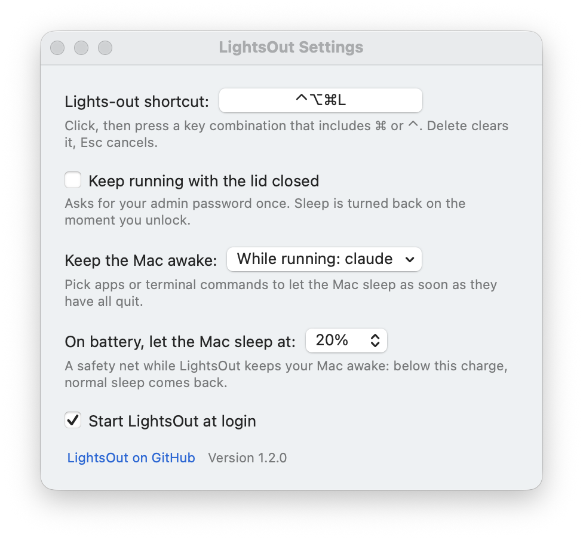
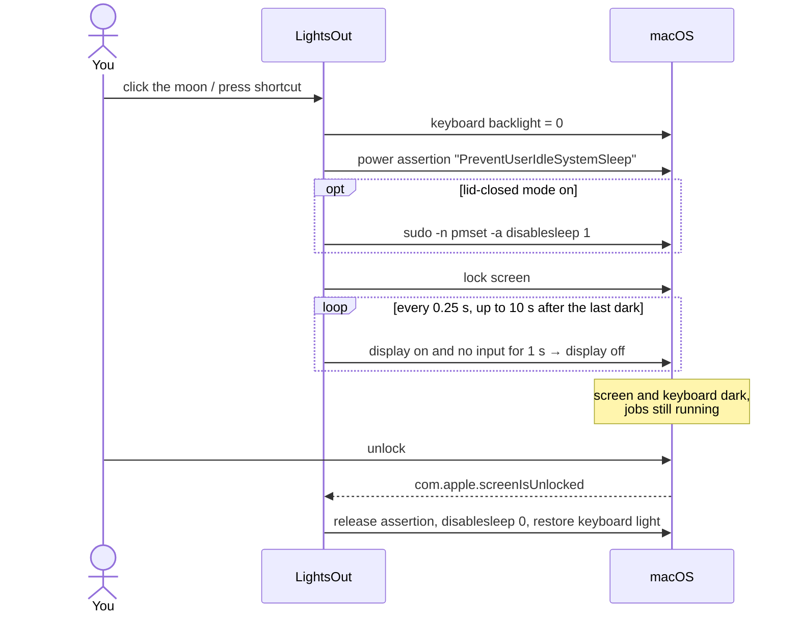

<p align="center">
  
</p>

<h1 align="center">LightsOut</h1>

<p align="center">
  <b>One click to go dark. Your Mac keeps working.</b><br>
  A tiny menu bar app that turns off your MacBook's screen and keyboard light and locks it,<br>
  while Claude Code, builds, downloads and training runs keep going. Lid open or closed.
</p>

<p align="center">
  <a href="https://github.com/sickpuppy1/lightsout/releases/latest"></a>
  
  
  <a href="https://github.com/sickpuppy1/lightsout/actions/workflows/build.yml"></a>
  <a href="LICENSE"></a>
</p>

---

## The problem

AI coding agents like Claude Code can run for minutes or hours. When you step away, you have two bad options:

- **Leave the lid open.** The screen and keyboard glow all night.
- **Close the lid.** The Mac sleeps and your agent session, build or download stops.

So people tilt the lid *almost* shut and hope the screen turns off without the Mac going to sleep.

**LightsOut is the third option.** Click the moon in your menu bar (or press your shortcut), and every light on the laptop goes off
and the Mac locks. Your work keeps running until you come back. If you turn on lid-closed mode, you can also close the lid.

## Features

| | |
| --- | --- |
| 🌙 **One click or one shortcut** | Click the menu bar moon or press a keyboard shortcut you choose. |
| ⌨️ **Keyboard light off** | Backlight goes to 0, and comes back to your level when you unlock. |
| 🔒 **Locks instantly** | The same lock as <kbd>⌃</kbd> <kbd>⌘</kbd> <kbd>Q</kbd>. |
| 🖥️ **Screen off, and it stays off** | Waits until your hands leave the trackpad. If a stray touch wakes the display in the next 10 s, it goes dark again. |
| ⚡ **Keeps working** | Holds the Mac awake while locked, so jobs aren't paused. |
| 🎯 **Only as long as you need** *(optional)* | Pick apps or terminal commands, like `claude`, and normal sleep returns once they've all quit. |
| 💻 **Lid-closed mode** *(optional)* | Close the lid and the Mac keeps running. Asks for your admin password once. |
| 🔋 **Battery safety net** | On battery, normal sleep returns below a charge level you pick (default 20%). |
| ↩️ **Back to normal on unlock** | Your usual sleep settings return the moment you unlock, after a quit, and after a crash or restart. |

## Install

### Option 1: Download (no tools needed)

1. Download **[LightsOut.dmg](https://github.com/sickpuppy1/lightsout/releases/latest/download/LightsOut.dmg)** and open it.
2. Double-click **LightsOut**. It copies itself to Applications, starts at login, and shows a moon in your menu bar.

> **First launch:** LightsOut is not yet notarized by Apple (that needs a paid developer account), so macOS asks you to approve it once.
> - **macOS 15 Sequoia and later:** click *Done*, then go to **System Settings → Privacy & Security**, scroll down and click **Open Anyway**.
> - **macOS 14 and earlier:** right-click **LightsOut** → **Open** → **Open**.

### Option 2: Build from source (no Gatekeeper prompt)

```bash
git clone https://github.com/sickpuppy1/lightsout.git
cd lightsout
./install.sh
```

This needs only Apple's free Command Line Tools (`xcode-select --install`). If `git` works, you already have them.
Apps you compile yourself are not quarantined, so macOS doesn't ask for approval.

## Use it

- **Click the moon** to turn everything off. **Unlock** as usual to come back.
- **Right-click the moon** for *Lights Out Now*, *Settings…* and *Quit*.

### Settings

<p align="center">
  <picture>
    <source media="(prefers-color-scheme: dark)" srcset="assets/settings-dark.png">
    
  </picture>
</p>

- **Lights-out shortcut:** click the button and press a combination that includes <kbd>⌘</kbd> or <kbd>⌃</kbd>, for example
  <kbd>⌃</kbd><kbd>⌥</kbd><kbd>⌘</kbd><kbd>L</kbd>. F-keys work on their own. <kbd>Delete</kbd> clears it, <kbd>Esc</kbd> cancels.
  No shortcut is set by default.
- **Keep running with the lid closed:** see [Lid-closed mode](#lid-closed-mode).
- **Keep the Mac awake:** *Until I unlock* (default), or tick any running apps and terminal commands (`claude`, `npm`,
  `xcodebuild`…). LightsOut checks every 15 s, and once all of them have quit, normal sleep returns, even while locked.
  The whole Mac stays awake while they run, because macOS can't keep a single app awake.
- **On battery, let the Mac sleep at:** Never, 10%, 20% (default), 30% or 50%.
- **Start LightsOut at login:** on by default.

## Lid-closed mode

macOS always sleeps when you close the lid. The only switch that overrides this, `pmset -a disablesleep 1`, needs root.
LightsOut asks for your password **once**, when you tick the box, and installs this sudo rule:

```
# /etc/sudoers.d/lightsout
<you> ALL=(root) NOPASSWD: /usr/bin/pmset -a disablesleep 1, /usr/bin/pmset -a disablesleep 0
```

The rule lets LightsOut run exactly those two commands and nothing else. It is checked with `visudo` before it is installed.
From then on:

- **Lights out:** sleep is disabled, so you can close the lid.
- **Unlock:** sleep is enabled again, silently and immediately.

Unticking the box (or running `./uninstall.sh`) asks for your password again and removes the rule.

### Your Mac is never left stuck awake

| When | What LightsOut does |
| --- | --- |
| You unlock | Releases the stay-awake hold, turns sleep back on, restores the keyboard light |
| Battery falls to your cutoff | Releases the hold and turns sleep back on, even while locked |
| The apps or commands you picked have all quit | Same, even while locked |
| You quit LightsOut, log out or shut down | Same clean-up before exiting (it also handles `SIGTERM` from `launchd`) |
| Crash, force quit or power loss | A "sleep is disabled" flag is saved to disk first, and the next launch turns sleep back on |
| You had disabled sleep yourself | LightsOut leaves it alone and never turns it back on for you |

This holds in both modes. Without lid-closed mode, LightsOut only holds an ordinary power assertion (no root involved).

## How it works



| Job | How | Notes |
| --- | --- | --- |
| Stay awake (lid open) | IOKit power assertion `PreventUserIdleSystemSleep` | Same as `caffeinate -i`: the display may sleep, the system may not. Visible in `pmset -g assertions`. |
| Stay awake (lid closed) | `pmset -a disablesleep 1` through a one-command sudo rule | Opt-in. A flag saved to disk makes sure it is always undone. |
| Lock | `SACLockScreenImmediate()` from `login.framework` | The function behind <kbd>⌃⌘Q</kbd>. Falls back to `CGSession -suspend` on older macOS. |
| Display off | `pmset displaysleepnow` | Waits until `HIDIdleTime` (seconds since last keyboard/trackpad input) ≥ 1 s. |
| Keyboard light | `KeyboardBrightnessClient` from `CoreBrightness.framework` | The same interface Control Center uses. |
| Picked apps and commands | `NSRunningApplication` for apps; each process's `argv[0]` (`sysctl KERN_PROCARGS2`) for commands | `argv[0]`, because Claude Code's binary is named after its version. Checked every 15 s. |
| Shortcut | Carbon `RegisterEventHotKey` | System-wide, and needs **no Accessibility permission**. |
| Battery cutoff | IOKit power-source notifications | Re-checked on every plug/unplug and charge change. |
| Start at login | A LaunchAgent in `~/Library/LaunchAgents` | Behaves the same on every macOS version. Restarts after a crash, not after Quit. |

**Why the hands-off wait?** The first version turned the display off after a fixed 1 s delay, and the lock screen kept coming back.
`pmset -g log` showed why: the finger still resting on the trackpad sent a touch event that woke the display in the same second.
Now LightsOut waits for 1 s of no input, then guards for 10 s and turns the display off again if a stray touch wakes it.

## Privacy and permissions

- **No Accessibility, Screen Recording or Full Disk Access prompts.** The keyboard shortcut works without them.
- **Admin password only if you turn on lid-closed mode.** It is used once, for the single rule shown above.
- **No network access, no analytics, no data collected.**
- **Small enough to read:** about 1,250 lines of Objective-C in [`src/`](src).

## Compatibility

| | |
| --- | --- |
| macOS | 10.13 High Sierra and later (Apple Silicon needs 11 Big Sur or later) |
| Hardware | Any Mac. Keyboard-light control applies to MacBooks with a backlit keyboard. |
| Tested on | macOS 15.6, MacBook Air (M1); macOS 26.6.2, MacBook Air (M5). Reports from other versions are welcome. |

## FAQ

**Can I close the lid?**
Yes, with lid-closed mode turned on in Settings. Without it, keep the lid open; the screen and keyboard are dark anyway.

**Is it safe to close the lid and put the Mac in a bag?**
A closed Mac that can't sleep keeps running and gets warm in a bag. Lid-closed mode is meant for a desk.
The battery cutoff is a safety net, not a substitute for that.

**Why not just run `caffeinate`?**
`caffeinate` keeps the Mac awake but leaves the screen and keyboard lit, doesn't lock, doesn't survive a lid close, and stays on
until you remember to kill it. LightsOut does all of it in one step and hands sleep back to macOS when you unlock.

**Private APIs? Will this break?**
The lock and keyboard-light calls use undocumented Apple frameworks. They are loaded at runtime and checked first, so if a future macOS
removes one, LightsOut skips that step and still turns off the display.

**Why Objective-C and not Swift?**
It compiles with the stock `clang` that ships in Command Line Tools, with no Xcode project. It also runs on macOS versions older than
10.14.4, which don't include the Swift runtime.

## Uninstall

Run `./uninstall.sh`. It quits the app and removes it, the login entry, the lid-closed sudo rule (asks for your password) and the settings.

If you'd rather delete the app by hand, untick **Keep running with the lid closed** in Settings first, so the sudo rule is removed too.

## Project layout

```
src/main.m                     app delegate: menu bar item, lights-out sequence, self-install, clean-up
src/Hotkey.{h,m}               system-wide shortcut (Carbon RegisterEventHotKey)
src/ShortcutRecorder.{h,m}     the "press a shortcut" button
src/LidMode.{h,m}              lid-closed mode: sudo rule install/remove, disablesleep on/off
src/Battery.{h,m}              battery level and power-source change notifications
src/Processes.{h,m}            running apps and terminal commands, for "keep awake while these run"
src/SettingsWindowController.{h,m}  the Settings window, built in code
src/Keys.h                     settings keys and defaults
Info.plist                     bundle metadata (menu-bar-only app, macOS 10.13+)
build.sh                       compile a universal LightsOut.app into build/
install.sh / uninstall.sh      install from source / remove everything
release.sh                     build dist/LightsOut.dmg (optionally Developer ID signed + notarized)
assets/make-icon.swift         draws the app icon in code and writes AppIcon.icns
```

## Releasing

```bash
./release.sh                       # ad-hoc signed DMG in dist/
SIGN_ID="Developer ID Application: Name (TEAMID)" \
NOTARY_PROFILE=notary ./release.sh # signed, notarized, stapled: opens with no prompt
```

## License

[MIT](LICENSE). Free to use, modify and share.
